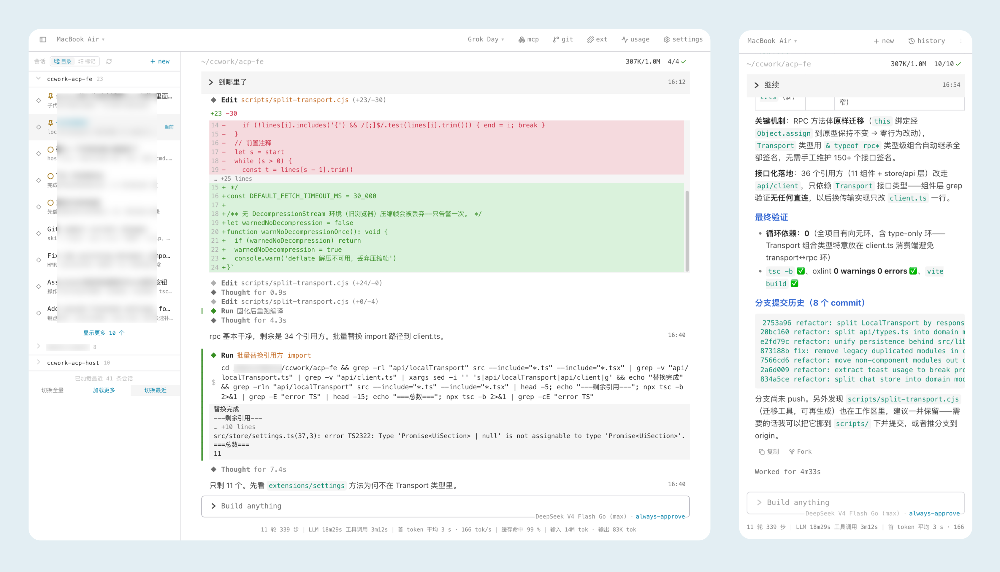

<p align="center">
  
</p>

<h1 align="center">Capri Hub</h1>

<p align="center">
  <strong>汇集你的所有 Capri Host</strong><br />
  <em>Capricorn · AgentsHarness 的第一颗星座</em>
</p>

<p align="center">
  <a href="https://github.com/AgentsHarness/capri-hub/releases"></a>
  <a href="https://github.com/AgentsHarness"></a>
  
  
</p>

---

[AgentsHarness](https://github.com/AgentsHarness) 让你随时随地远程使用 Agents。

**Capri**（Capricorn）是 [Grok Build](https://x.ai/cli) 的具体适配项目，我们基于 ACP 协议，搭配 capri-fe、capri-host 实现远程 Agent 控制。

Hub **不执行**任何命令，只做配对、发现和转发。

```
浏览器  ──▶  capri-hub :8787  ──▶  家里的 host
                           ──▶  办公室的 host
                           ──▶  服务器上的 host
```

只在一台机器上用？不必起 Hub，直接跑 [capri-host](https://github.com/AgentsHarness/capri-host) 即可。

## 截图



## 部署

### Docker（推荐）

```bash
cp .env.example .env       # 填 FE_TOKEN：openssl rand -hex 24
mkdir -p data && sudo chown -R 10001:10001 data
docker compose up -d
docker compose exec capri-hub capri-hub paircode    # ← 配对码在这里
```

多架构镜像（amd64 / arm64）在 `ghcr.io/agentsharness/capri-hub`。要自己构建，
国内机器得指定代理，否则 `go mod download` 会在 `proxy.golang.org` 上超时：

```bash
docker build --build-arg GOPROXY=https://goproxy.cn,direct -t capri-hub:local .
```

反向代理配置、UDP 8788 放行、迁移已有配对、排查清单见
**[docs/DOCKER.md](docs/DOCKER.md)**。

### 裸二进制

需要 Go 1.26+，或从 [Releases](https://github.com/AgentsHarness/capri-hub/releases) 下载。

```bash
# 生产务必设置 FE_TOKEN（浏览器门禁）
FE_TOKEN=$(openssl rand -hex 24) go run ./cmd/capri-hub
```

### 配对码

启动日志会打印 **6 位配对码**，15 分钟有效、过期自动轮换，所以那一行很快
就过时了。随时查看当前有效的码：

```bash
capri-hub paircode           # 本机
capri-hub paircode -rotate   # 立刻换一个新的（旧码失效）
capri-hub paircode -json     # 给脚本用
```

也可以走 API（设了 `FE_TOKEN` 之后需要带 token）：

```bash
curl -H "Authorization: Bearer $FE_TOKEN" http://127.0.0.1:8787/api/pairing
curl -X POST -H "Authorization: Bearer $FE_TOKEN" http://127.0.0.1:8787/api/pairing/rotate
```

默认端口：HTTP `8787`，QUIC UDP `8788`（无 QUIC 则 WebSocket）。

## 把 Host 接进来

在每台有 grok build 的机器上：

```bash
# 自行修改
HUB_URL=https://<hub>
HUB_PAIR_CODE=XXXXXX
HOST_ID=pc
HOST_NAME="家里的 Mac"
# 可选：这台 Host 自己接口的密钥，和上面的 Hub FE_TOKEN 是两把、不必同值。
# 本机跑 Host 又想让浏览器直连本机端口，留空最省事（默认只听回环）。
FE_TOKEN=
nohup ./capri-host >> capri-host.log 2>&1 & echo $! > capri-host.pid
```

配对一次即可，token 记在那台机器的 `~/.capri-host/hub.json`。然后用浏览器打开 `https://<hub>`，输入刚才的 `FE_TOKEN`，从左上角切换 Host。

## 多用户

Hub 支持在一台实例上接入多个互相隔离的用户：

- `FE_TOKEN` 是 root 管理员令牌，管理员在「设置 → 访问与分享 → 用户」里创建用户。
- 创建用户时只展示一次明文 token；hub 只保存 SHA-256 哈希，之后管理员看不到它，只能重置 token 或删除用户。
- 用户用自己的 token 登录后，打开「添加 Host」拿到的配对码属于该用户；用这个码配对的 host 只出现在该用户的 host 列表里。
- 普通用户只能访问自己名下 host 的 `/api/*`、事件流和偏好设置。
- 管理员在 host 列表里也只能看到自己配对的 host，无法访问其他用户的 host；管理员权限只体现在「用户」管理页，可查看每个用户配对的 host、创建用户、重置 token 和删除用户。管理员看不到用户 token。
- 用户可以在「设置 → 账号」里自行更换 token，旧 token 立即失效。
- 同一用户接多台 host 时请给每台设置不同的 `HOST_ID`；`HOST_ID` 默认是 `local`，复用同一个 id 会把上一台顶掉。

用户数据保存在 `HUB_DATA_DIR/users.json`，每个用户的偏好保存在
`prefs-users.json`。备份 Hub 时把这几个文件一起备份即可。

## 常用变量

| 变量               | 默认   | 说明                                    |
| ------------------ | ------ | --------------------------------------- |
| `PORT`             | `8787` | HTTP 端口                               |
| `QUIC_PORT`        | `8788` | Host 主通道（UDP）                      |
| `FE_TOKEN`         | —      | root 管理员浏览器密钥；普通用户使用 `users.json` 中的用户 token。生产必设。与各台 Host 自己的 `FE_TOKEN` 相互独立，不要求同值 |
| `REQUIRE_FE_TOKEN` | —      | 设为 `1` 时，没配 `FE_TOKEN` 会拒绝启动 |
| `HUB_DATA_DIR`     | `~/.capri-hub` | 状态目录（`hub.json` / `prefs.json` / `users.json` / `prefs-users.json` / `guests.json`）。容器部署设为 `/data` |
| `QUIC_ALLOW_SELF_SIGNED` | — | 设了 `FE_TOKEN` 又没有真证书时，必须设为 `1`，否则 QUIC 关闭、Host 退回 WebSocket |
| `CORS_ORIGINS`     | `*`    | 生产写成前端真实源                      |
| `CAPRI_LOG_LEVEL`    | `info` | 设为 `debug` 才打印每条被拒事件的逐条明细（seq 回退、非对象事件跳过）；非法值回落 `info` |

## 项目生态

|                     项目                                      |            简介               |
| --------------------------------------------------------- | ------------------------- |
| [AgentsHarness](https://github.com/AgentsHarness)         | 总项目                    |
| [capri-host](https://github.com/AgentsHarness/capri-host) | Agent 节点，内嵌 Capri FE |
| [capri-fe](https://github.com/AgentsHarness/capri-fe)     | WebUI                     |

## 友情链接

[Linux.do](https://linux.do)

MIT
